<p align="center">
  
</p>

<p align="center">
  
  
  
  
  
  <a href="https://github.com/MYSiddique2005/Byte-Supply-E-Commerce-Business-Analytics/actions/workflows/pipeline.yml"></a>
</p>

<p align="center">
  <a href="https://mysiddique2005.github.io/Byte-Supply-E-Commerce-Business-Analytics/"><b>🚀 Live Interactive Dashboard</b></a> ·
  <a href="notebooks/Byte_Supply_Big_Data_Analytics.ipynb"><b>📓 Notebook</b></a> ·
  <a href="#-key-insights"><b>💡 Insights</b></a> ·
  <a href="#-machine-learning-forecast"><b>🤖 ML Forecast</b></a> ·
  <a href="#-quick-start"><b>⚡ Quick Start</b></a>
</p>

---

## 📌 Overview

**Byte Supply** is a Malaysian online retailer selling small electronics, computer peripherals, phone accessories and office products. This project turns **five years of transaction data (Oct 2021 – Sep 2026)** into business intelligence:

- 📊 **KPI analysis** — revenue, profit, AOV, margin, ratings, delivery and retention
- 📈 **11 publication-quality charts** + an **interactive Plotly dashboard**
- 🔍 **Segment analysis** — category, state, device, customer segment, payment method, courier
- 🤖 **Machine learning** — Linear vs Polynomial Regression on monthly revenue
- 🔮 **12-month revenue forecast** with business recommendations

> Built for the **INTI International University Mobility Program** (Big Data Analytics coursework).
> The dataset is **synthetic** and is used to demonstrate a complete analytics workflow.

---

## 🎯 Headline KPIs

<table>
  <tr>
    <td align="center"><h3>RM 2.04M</h3><sub>Total revenue</sub></td>
    <td align="center"><h3>24,991</h3><sub>Orders</sub></td>
    <td align="center"><h3>17,863</h3><sub>Unique customers</sub></td>
    <td align="center"><h3>RM 81.67</h3><sub>Average order value</sub></td>
  </tr>
  <tr>
    <td align="center"><h3>36.5%</h3><sub>Gross margin</sub></td>
    <td align="center"><h3>4.02 ★</h3><sub>Average rating</sub></td>
    <td align="center"><h3>89.6%</h3><sub>On-time delivery</sub></td>
    <td align="center"><h3>+23.7%</h3><sub>Revenue growth (Year 5)</sub></td>
  </tr>
</table>

<details>
<summary><b>📅 Business-year scorecard</b> (a business year runs October → September)</summary>

| Year | Orders | Revenue (RM) | Gross profit (RM) | AOV (RM) | Growth | Margin | Avg rating | On-time | Stock-out |
|:---:|---:|---:|---:|---:|---:|---:|---:|---:|---:|
| 1 | 3,611 | 280,236 | 102,214 | 77.61 | — | 36.5% | 3.95 | 85.8% | 4.0% |
| 2 | 4,244 | 341,190 | 123,851 | 80.39 | +21.8% | 36.3% | 4.00 | 88.4% | 3.0% |
| 3 | 4,746 | 382,750 | 139,631 | 80.65 | +12.2% | 36.5% | 3.97 | 88.5% | 3.2% |
| 4 | 5,572 | 463,602 | 168,748 | 83.20 | +21.1% | 36.4% | 4.05 | 91.0% | 2.4% |
| 5 | 6,818 | 573,283 | 209,542 | 84.08 | +23.7% | 36.6% | 4.09 | 92.1% | 1.7% |

</details>

---

## 🖥️ Interactive Dashboard

The [**live dashboard**](https://mysiddique2005.github.io/Byte-Supply-E-Commerce-Business-Analytics/) (`docs/index.html`) is a single static page built with Plotly — no server required.

| Feature | Interaction |
|---|---|
| Revenue trend | Toggle **Revenue / Profit / Orders**, zoom with the range slider, 1y / 2y / All presets |
| Category performance | Switch between **Revenue / Gross margin / Gross profit** |
| Customer & channel explorer | Dropdown to slice by **State, Device, Segment, Age group, Courier, Customer type** — hover shows AOV, rating, on-time % |
| Top 10 products | Coloured by category, hover for units & profit |
| Heatmaps | Seasonality (month × year) and shopping hours (hour × weekday) |
| Payment mix | Click legend items to isolate methods |
| ML forecast | Actual vs predicted on the test window + 12-month forecast |

> Open `docs/index.html` locally in any browser to explore it offline.

---

## 📊 Visual Analytics

### Monthly revenue trend
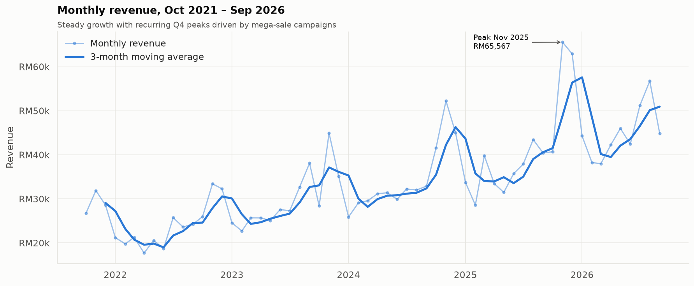

### Category performance
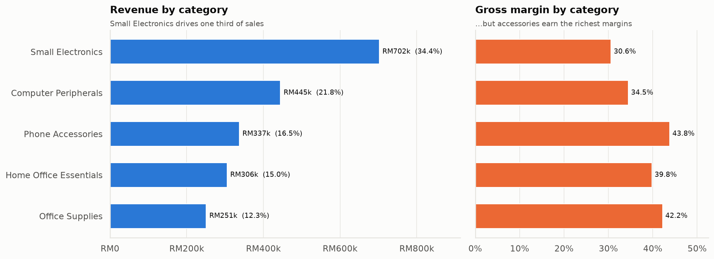

<table>
  <tr>
    <td width="50%">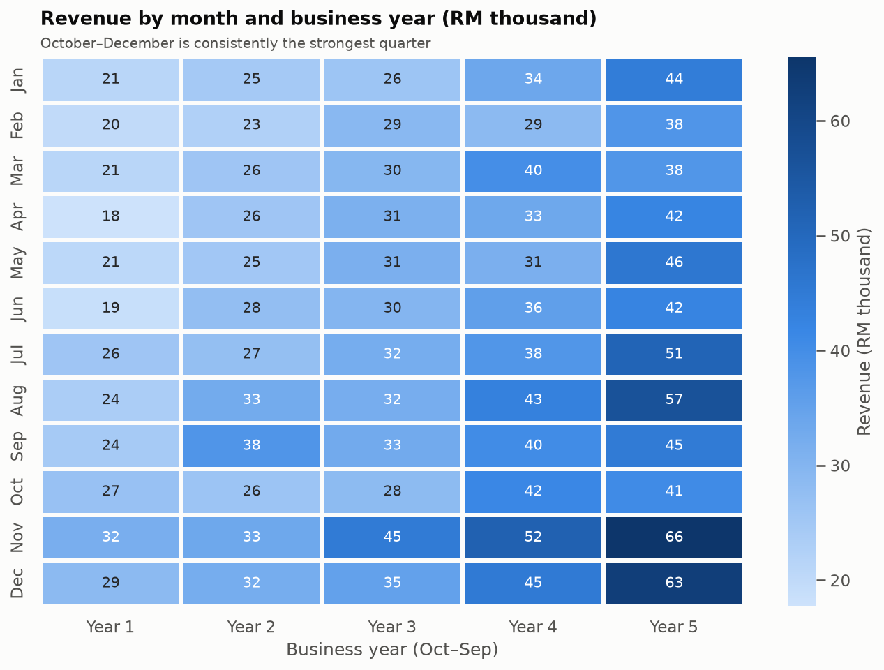</td>
    <td width="50%">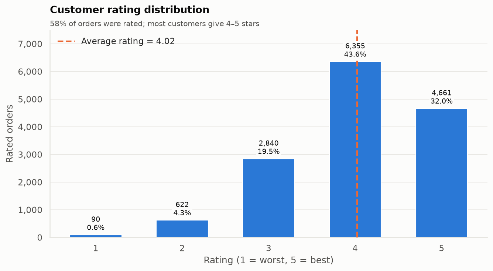</td>
  </tr>
  <tr>
    <td align="center"><sub><b>Seasonality</b> — Q4 is the strongest quarter every year</sub></td>
    <td align="center"><sub><b>Ratings</b> — 75% of rated orders score 4–5 stars</sub></td>
  </tr>
</table>

### When customers shop
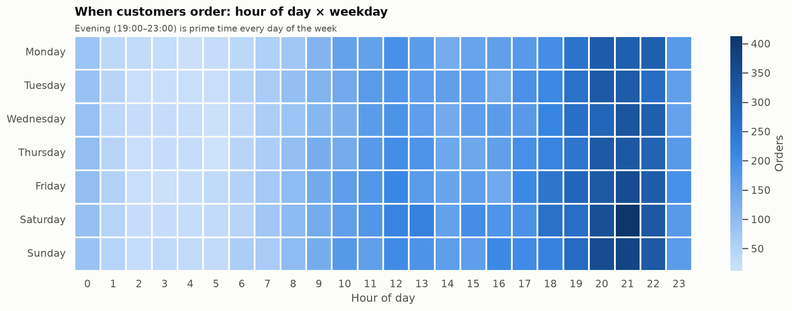

<table>
  <tr>
    <td width="55%">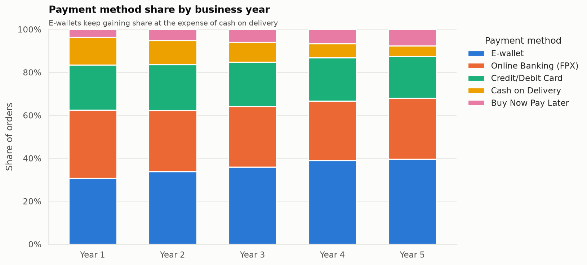</td>
    <td width="45%">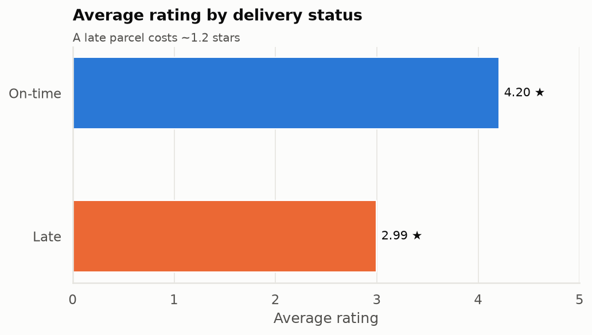</td>
  </tr>
  <tr>
    <td align="center"><sub><b>Payment mix</b> — e-wallets rising, COD declining</sub></td>
    <td align="center"><sub><b>Delivery</b> — a late parcel costs ~1.2 stars</sub></td>
  </tr>
</table>

<details>
<summary><b>More charts</b></summary>

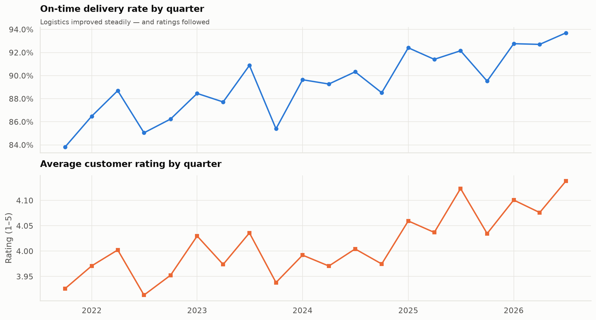

</details>

---

## 💡 Key Insights

| # | Insight | 📌 Recommendation |
|:-:|---|---|
| 1 | **29.2%** of annual revenue lands in **Q4** (Oct–Dec); Nov is the peak month | Secure inventory and courier capacity by September; build campaigns around 10.10 / 11.11 / 12.12 |
| 2 | Mega-sale days run at **25.1% margin** vs **36.8%** on normal days | Use mega-sales for acquisition, but bundle high-margin accessories to protect profit |
| 3 | Late deliveries average **2.99★** vs **4.20★** when on time | Courier SLAs and routing peak-season orders to the most reliable courier |
| 4 | **34.8%** of orders are placed between **19:00 and 23:00** | Time push notifications, flash deals and ads for the evening window |
| 5 | **E-wallet** share grew from ~31% to ~40%; cash on delivery is shrinking | E-wallet cashback partnerships; reduce COD handling costs |
| 6 | **Small Electronics** = 34% of sales but the **lowest margin (30.6%)** | Cross-sell Phone Accessories / Office Supplies (42–44% margin) at checkout |
| 7 | Only **24.5%** of customers buy more than once | Loyalty / points programme targeted at first-time buyers |

---

## 🤖 Machine Learning Forecast

**Goal:** predict monthly revenue and forecast the next 12 months.

- **Features:** `time_index` (trend), `month`, `month_sin`, `month_cos` (cyclical seasonality)
- **Validation:** chronological **80/20 split** — train on 48 months, test on the final 12 (no look-ahead leakage)

| Model | MAE (RM) | RMSE (RM) | MAPE | R² |
|---|---:|---:|---:|---:|
| 🏆 **Polynomial Regression (degree 2)** | **5,063** | **6,077** | **9.9%** | **0.54** |
| Linear Regression | 6,453 | 8,256 | 12.2% | 0.15 |

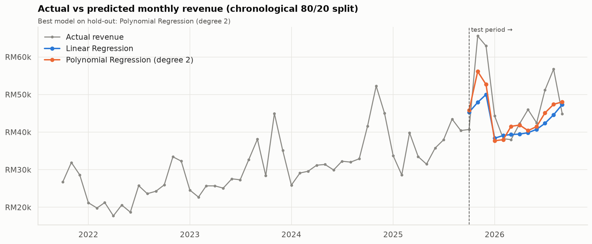

The polynomial model is refitted on all 60 months to produce the forecast — **≈ RM 687k over Oct 2026 – Sep 2027**, with a projected November peak of ~RM 72k.

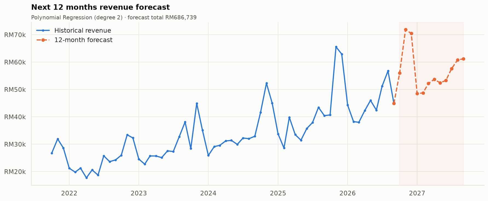

<details>
<summary><b>Residual analysis</b></summary>

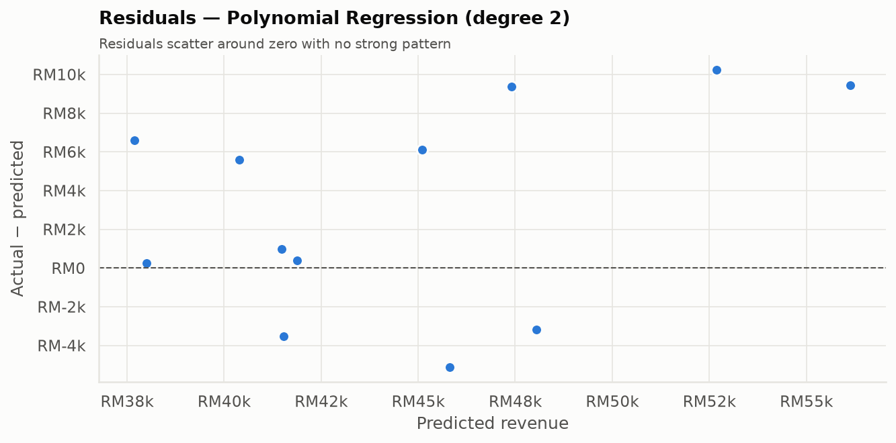

</details>

---

## 🔄 Analytics Pipeline

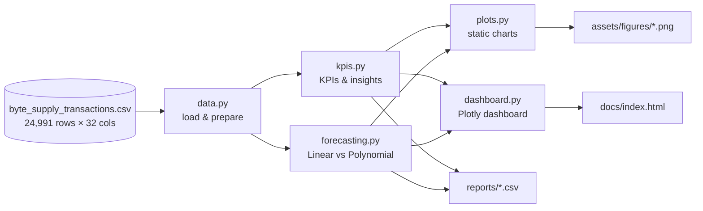

---

## 🗂️ Dataset

`data/byte_supply_transactions.csv` — **24,991 transactions × 32 columns**, Oct 2021 – Sep 2026.

| Group | Columns |
|---|---|
| 🕒 Time | `Date_Time`, `Date`, `Year`, `Month`, `Day`, `Hour`, `Day_of_Week`, `Is_Campaign_Day` |
| 👤 Customer | `Customer_ID`, `Customer_Age_Group`, `Customer_Segment`, `Customer_State`, `Customer_Type`, `Device` |
| 📦 Product | `Product_ID`, `Product_Name`, `Category`, `Quantity`, `Unit_Price`, `Discount_Pct`, `Unit_Cost` |
| 💰 Financial | `Total_Amount`, `Gross_Profit`, `Payment_Method` |
| 🚚 Operations | `Courier`, `Stock_Level_Before`, `Stock_Out_Flag`, `Promised_Delivery_Days`, `Actual_Delivery_Days`, `Delivery_Status` |
| ⭐ Feedback | `Rating` (1–5; ~42% missing — kept as missing, not imputed) |

---

## 📁 Project Structure

```text
Byte-Supply-E-Commerce-Business-Analytics/
├── data/
│   └── byte_supply_transactions.csv     # synthetic transaction dataset
├── notebooks/
│   └── Byte_Supply_Big_Data_Analytics.ipynb   # full analysis story
├── src/byte_supply/                     # reusable analytics package
│   ├── config.py                        # paths, palette, constants
│   ├── data.py                          # loading & feature preparation
│   ├── kpis.py                          # KPI and insight calculations
│   ├── forecasting.py                   # regression models & forecast
│   ├── plots.py                         # matplotlib / seaborn charts
│   └── dashboard.py                     # interactive Plotly dashboard
├── scripts/
│   ├── run_pipeline.py                  # one command → charts, reports, dashboard
│   └── build_notebook.py                # regenerates the notebook
├── assets/figures/                      # exported charts (used in this README)
├── reports/                             # KPI, model and forecast tables (CSV)
├── docs/index.html                      # interactive dashboard (GitHub Pages)
├── .github/workflows/pipeline.yml       # CI: runs pipeline + notebook
├── Makefile
└── requirements.txt
```

---

## ⚡ Quick Start

```bash
# 1. Clone
git clone https://github.com/MYSiddique2005/Byte-Supply-E-Commerce-Business-Analytics.git
cd Byte-Supply-E-Commerce-Business-Analytics

# 2. Create an environment and install dependencies
python -m venv .venv
source .venv/bin/activate          # Windows: .venv\Scripts\activate
pip install -r requirements.txt

# 3. Regenerate every chart, report and the dashboard
python scripts/run_pipeline.py     # or: make pipeline

# 4. Explore the notebook
jupyter lab notebooks/Byte_Supply_Big_Data_Analytics.ipynb
```

Outputs: `assets/figures/*.png`, `reports/*.csv`, `docs/index.html`.

---

## 🛠️ Tech Stack

| Purpose | Tools |
|---|---|
| Data wrangling | pandas, NumPy |
| Static visualisation | Matplotlib, Seaborn |
| Interactive visualisation | Plotly |
| Machine learning | scikit-learn (LinearRegression, PolynomialFeatures, Pipeline) |
| Environment | Jupyter, GitHub Actions, GitHub Pages |

---

## ⚠️ Limitations

- The dataset is **synthetic** — patterns illustrate the workflow rather than real Malaysian consumer behaviour.
- The data is a stored CSV, not a live stream; *velocity* is demonstrated through timestamp-level analysis.
- 60 monthly observations is a small sample for ML — the forecast is a **model-based estimate**, not a guarantee.
- Rating KPIs describe **rated orders only** (~58% of orders).

---

## 👤 Author

**[MYSiddique2005](https://github.com/MYSiddique2005)**

Developed as part of the **INTI International University Mobility Program** — Big Data Analytics coursework.

<p align="center"><sub>⭐ If you found this project useful, consider giving it a star!</sub></p>
